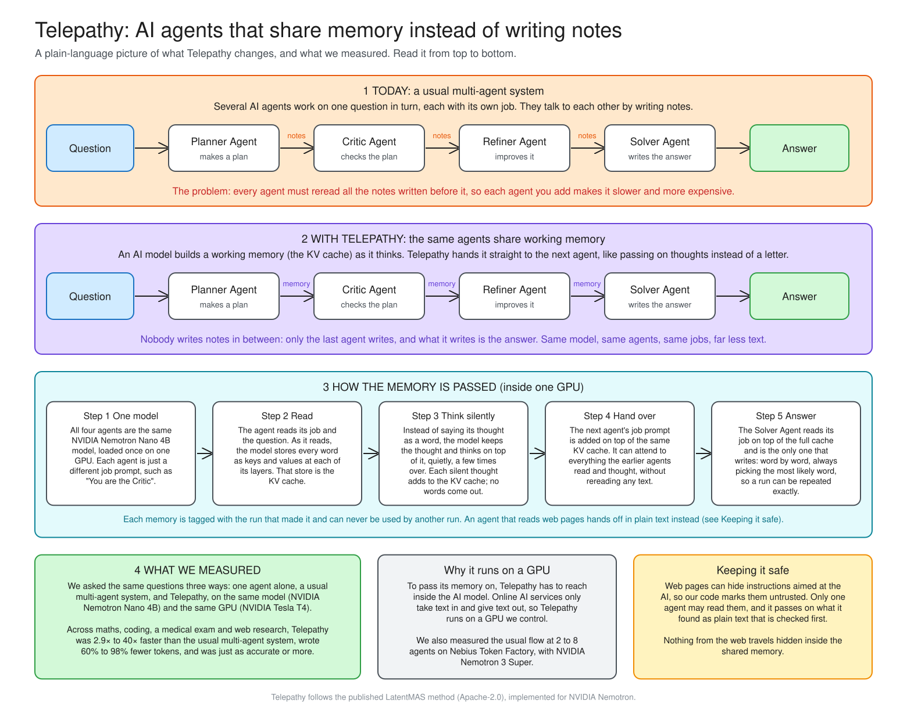

<div align="center">

# Telepathy

### AI agents that think together, without writing it all out

Multi-agent systems spend much of their time writing to each other. Telepathy lets agents share their working memory instead, on NVIDIA Nemotron.

**2.9× to 40× faster** &nbsp;·&nbsp; **60% to 98% fewer tokens** &nbsp;·&nbsp; **same or better accuracy**<br>compared with a usual multi-agent system, on the same model and the same questions

</div>

---

## Contents

1. [The problem](#1-the-problem)
2. [The idea](#2-the-idea)
3. [Results](#3-results)
4. [Where it is in the code](#4-where-it-is-in-the-code)
5. [Run it yourself](#5-run-it-yourself)
6. [Configuration](#6-configuration)
7. [Troubleshooting](#7-troubleshooting)
8. [Credits](#8-credits)

---

## 1. The problem

A multi-agent system splits a job between specialist agents. In our demo team a **Planner Agent** makes a plan, a **Critic Agent** checks it, a **Refiner Agent** improves it and a **Solver Agent** writes the answer.

Today those agents hand work to each other by **writing everything out**. Each agent writes its full reasoning, and the next agent has to read all of it before it can start. Add an agent and there is more to write and far more to read, so every agent you add costs time and money.

We measured it on Nebius Token Factory with NVIDIA Nemotron 3 Super (the same 50 maths questions at every team size):

| Agents in the team | Tokens read per question | Tokens written | Seconds per question | Right answers |
|:---:|:---:|:---:|:---:|:---:|
| 2 | 416 | 358 | 2.8 | 92% |
| 4 | 2,661 | 1,319 | 8.8 | 92% |
| 6 | 6,723 | 2,136 | 13.1 | 96% |
| 8 | **12,019** | 2,487 | 16.4 | 96% |

Going from 2 to 8 agents, reading grows about **29×** while accuracy stays within noise. Most of the extra cost is agents re-reading each other.

## 2. The idea

What if the agents skipped the notes and handed over what they are thinking?

When a language model reads text, it builds a working memory of what it has understood so far (technically, its **KV cache**). Normally that memory is thrown away after each answer, and the next agent rebuilds it by reading text. Telepathy keeps it and passes it on.

Each of the first three agents **thinks silently**: instead of writing a word, the model feeds its own last internal state back in as the next input. Their thinking accumulates in the shared memory, and only the Solver writes, which is the answer.



## 3. Results

Everything below uses **one model** (NVIDIA Nemotron Nano 4B) on **one GPU** (NVIDIA Tesla T4 on Kaggle), answering the **same questions three ways**: a single agent, a usual multi-agent system (4 agents writing notes), and Telepathy (the same 4 agents sharing memory).

| Test | Single agent | Multi-agent | **Telepathy** | Telepathy vs multi-agent |
|---|:---:|:---:|:---:|---|
| **School maths** ([GSM8K](https://huggingface.co/datasets/openai/gsm8k))<br>150 questions | 79.3%<br>13.6 s · 291 tokens | 69.3%<br>70.2 s · 1,267 tokens | **72.7%**<br>16.4 s · 283 tokens | **4.3× faster, 78% fewer tokens** |
| **Coding** ([MBPP+](https://huggingface.co/datasets/evalplus/mbppplus))<br>60 questions | 43.3%<br>3.8 s · 77 tokens | 43.3%<br>188.4 s · 2,723 tokens | **55.0%**<br>4.7 s · 55 tokens | **40× faster, 98% fewer tokens** |
| **Medical exam** ([MedQA](https://huggingface.co/datasets/GBaker/MedQA-USMLE-4-options))<br>60 questions | 33.3%<br>17.3 s · 316 tokens | 33.3%<br>96.5 s · 1,427 tokens | **41.7%**<br>28.1 s · 377 tokens | **3.4× faster, 74% fewer tokens** |
| **Web research** ([our questions](server/gallery.json))<br>3 questions | – | 2 of 3<br>230.7 s · 3,045 tokens | **2 of 3**<br>80.5 s · 1,228 tokens | **2.9× faster, 60% fewer tokens** |

**What this shows**

- **Speed and cost:** against the usual multi-agent system, Telepathy was faster and wrote far fewer tokens on **every** test.
- **Accuracy:** Telepathy was at least as accurate as the usual multi-agent system on every test.
- **Where it clearly won:** on coding, Telepathy solved 7 problems the single agent missed and missed none the single agent solved (sign test, p = 0.016).
- **Where it did not:** on simple school maths, **a single agent beat both teams** (79% against 73% and 69%). A team does not always pay off. Telepathy makes a team about as cheap as one agent; it does not make the model smarter.

<details>
<summary><b>Things that did not work</b></summary>

- **Readable "subtitles" of the silent thinking.** We tried to show a readable summary of what each silent agent passes on and check it was faithful. Our check could not tell real subtitles from fake ones, so we do not claim them.
</details>

### Raw data

These are the raw numbers from everything we tested. For each question, the files record the answer, whether it was right, the time taken and the tokens used, so anyone can check our results.

**Main tests**

| What | Files |
|---|---|
| Maths, coding and medical exam: all three ways | [`test_rerun/`](bench/results/kaggle_run/saved/test_rerun), [`teams/`](bench/results/kaggle_teams/saved/teams) |
| Web research: 3 real questions | [`kaggle_research/`](bench/results/kaggle_research/saved/gallery) |
| Team size: 2 to 8 agents on Nebius | [`test/`](bench/results/test) |

**Other experiments we ran**

| What we tried | What happened | Files |
|---|---|---|
| The usual multi-agent flow on a **much bigger model** (Nemotron 3 Super on Nebius), same 150 maths questions | Usual multi-agent flow: 91% right, against 69% on the small model | [file](bench/results/test/gsm8k_tokenfactory_text.jsonl) |
| How long each agent should think silently (5, 10 or 20 steps), on 50 practice questions | All about the same (68–74%), so we used 10 | [`gate_summary.md`](bench/results/gate_summary.md) |
| Does the silent thinking itself make answers better? | No clear difference, so we claim speed and cost, not smarter answers | [`mismatch/`](bench/results/mismatch) |
| The 18 example questions behind the website | Usual flow 12 right, Telepathy 14 right, typically 6× faster | [`gallery/`](bench/results/gallery) |
| Our first research demos used made-up web pages | The usual flow got all 3 right and Telepathy none, so we replaced them with real web research | [`retired_gallery/`](bench/results/retired_gallery) |

## 4. Where it is in the code

```
telepathy/
├── telepathy/              the engine
│   ├── engine.py             teams, modes and the run loop
│   ├── latent.py             silent thinking steps
│   ├── roles.py              agent roles, task wording, team sizes
│   ├── trust.py  scan.py     the safety layer
│   ├── cache_utils.py        cache binding and copying
│   ├── llm.py                Nebius Token Factory client with budgets
│   ├── baseline_tf.py        the usual flow on Token Factory
│   └── tools/tavily.py       web search for research questions
├── bench/                  benchmarks, recordings, website data builders
│   └── results/              raw results (one JSON row per question)
├── server/                 FastAPI server: replays, live Nebius lane, limits
├── dashboard/              the website
├── tests/                  112 tests (run on CPU with a tiny model)
├── docs/                   architecture diagram, Devpost text, feedback
└── policy.yaml             safety policy, read at start-up
```

<details open>
<summary><b>The Telepathy engine</b> · <code>telepathy/engine.py</code>, <code>telepathy/latent.py</code></summary>

- **Loading:** one NVIDIA Nemotron Nano 4B model is loaded once and shared by all four roles ([`config.py`](telepathy/config.py)).
- **Silent steps:** an agent reads its prompt, then for each silent step the model's last hidden state is rescaled to the size of a normal word embedding and fed back in as the next input ([`latent.py`](telepathy/latent.py)). No words are produced, and the KV cache grows.
- **Hand-off:** the next agent starts from that same KV cache, so it "remembers" everything the earlier agents read and thought, without reading any notes.
- **Answer:** only the final agent decodes text.
- **Modes:** `single` (one agent), `text` (usual flow: every agent writes), `latent` (Telepathy) and `auto` (Telepathy with optional checks), so all ways run on identical code paths.
- **Roles:** wording for each role and task (maths, logic, coding, science, research) lives in [`roles.py`](telepathy/roles.py). Team sizes `team2`…`team8` are defined there too.
</details>

<details>
<summary><b>The safety layer</b> · <code>telepathy/trust.py</code>, <code>scan.py</code>, <code>cache_utils.py</code>, <code>policy.yaml</code></summary>

Passing hidden memory between agents creates a new risk: a planted instruction in a web page could travel silently. So:

- **Trust is set by code, never by the model.** Every piece of content carries a source. User input is trusted; web pages are untrusted, and nothing at runtime can upgrade them.
- **One reader.** Only one agent in a team may read outside content.
- **Tainted hand-offs are in text.** That agent must hand off in plain, readable text, decoded on a copy of the memory so raw untrusted tokens never enter the shared cache.
- **Scanned.** That text is checked for planted instructions; a scan can warn or block, never clear.
- **Memory belongs to one run.** Every cache is bound to its run id and refuses to be used by another; run state cannot be pickled or saved.
- **No secrets in prompts.** Prompts are checked for keys before they reach the model.
</details>

## 5. Run it yourself

You do **not** need a GPU or any paid keys to see the website or run the tests. Pick what you want to do:

| I want to… | What you need | Time | Cost |
|---|---|---|---|
| [See the website on my computer](#52-see-the-website) | Node.js | 5 minutes | free |
| [Check that the code works](#53-run-the-tests) | Python | 10 minutes | free |
| [Re-run our experiments](#54-re-run-our-experiments-on-a-free-gpu) | a free Kaggle account | 30 minutes to try, hours for the full tests | free |
| [Run the usual multi-agent flow on Nebius](#55-optional-run-the-usual-flow-on-nebius) | a Nebius Token Factory key | 10 minutes | a few cents to a few dollars |

### 5.1 Get the code

You need **Git**, **Python 3.11 or newer** ([download](https://www.python.org/downloads/)) and, for the website, **Node.js 20.19 or newer** ([download](https://nodejs.org)). Check what you have:

```bash
git --version
python3 --version
node --version
```

Then download the project and go into its folder:

```bash
git clone https://github.com/khushi-biyani/telepathy.git
cd telepathy
```

All the commands below start from this `telepathy` folder.

### 5.2 See the website

```bash
cd dashboard
npm install
npm run dev
```

`npm install` takes a minute the first time. Then open the address it prints, usually **http://localhost:5173**. You will see the same site as the online demo: the hand-off animation, the example questions and the results. Everything is replayed from real recordings saved in the repo, so it needs no GPU and no keys. Press `Ctrl+C` in the terminal to stop it.

### 5.3 Run the tests

This checks that the code works on your computer. From the `telepathy` folder:

```bash
python3 -m venv .venv
source .venv/bin/activate          # on Windows: .venv\Scripts\activate
pip install -r requirements.txt
python -m pytest -q
```

The first run downloads a tiny test model (about 270 MB). At the end you should see **112 passed**. The tests use the tiny model on your CPU, so they need no GPU and no keys.

### 5.4 Re-run our experiments on a free GPU

Telepathy has to run the AI model itself, which needs a GPU. Kaggle gives you one for free.

**Set up Kaggle (once)**

1. Create a free account at [kaggle.com](https://www.kaggle.com) and verify your phone number (Kaggle needs this before it lets you use a GPU or the internet).
2. Click **Create → New Notebook**.
3. In the notebook's right-hand panel, open **Session options**: set **Accelerator** to **GPU T4 x2** and switch **Internet** on.

**Download the project in the notebook.** Paste this into the first cell and run it:

```python
!git clone https://github.com/khushi-biyani/telepathy.git
%cd telepathy
!pip install -q transformers==5.19.0 datasets==5.1.0 openai python-dotenv httpx
```

**Try a quick run first (about 15 minutes).** This answers 5 maths questions with the usual multi-agent flow and with Telepathy, then prints a summary. The first run also downloads the model (NVIDIA Nemotron Nano 4B, about 8 GB).

```python
!python -m bench.run_bench --task gsm8k --split test --n 5 --modes text,latent --steps 10 --dtype float16 --device cuda --out bench/results/quick_try
!python -m bench.metrics bench/results/quick_try
```

In these commands, `--modes` chooses who answers: `single` is one agent alone, `text` is the usual multi-agent flow, and `latent` is Telepathy. `--n` is how many questions.

**Run the full tests.** Each command below reproduces one row of our results table:

| Test | Command | Time on a T4 |
|---|---|---|
| School maths, 150 questions | `!python -m bench.run_bench --task gsm8k --split test --modes single,text,latent --steps 10 --dtype float16 --device cuda --out bench/results/maths` | about 4 hours |
| Coding, 60 questions | `!python -m bench.run_bench --task mbppplus --split test --n 60 --modes single,text,latent --steps 10 --max-new-tokens 1024 --dtype float16 --device cuda --out bench/results/coding` | about 3 hours |
| Medical exam, 60 questions | `!python -m bench.run_bench --task medqa --split test --n 60 --modes single,text,latent --steps 10 --max-new-tokens 1024 --dtype float16 --device cuda --out bench/results/medical` | 2 to 3 hours |

Then print the summary for any of them, for example `!python -m bench.metrics bench/results/maths`.

**For runs longer than a few minutes**, don't keep the tab open: click **Save Version → Save & Run All (Commit)**. Kaggle then runs the notebook on its own servers, even with your browser closed, and keeps the results. When it finishes, download them from the notebook's **Output** tab. If a run stops halfway, run the same command again; it continues from where it stopped.

**What you get:** each run saves one file per way of answering (for example `gsm8k_test_latent_s10.jsonl`), with one line per question: the answer, whether it was right, the time taken and the tokens used. Our own files are in [`bench/results/`](bench/results) for comparison.

### 5.5 Optional: run the usual flow on Nebius

This runs the usual multi-agent flow, where agents write notes to each other, on the much bigger NVIDIA Nemotron 3 Super through Nebius Token Factory. It costs real money, so the code always lets you check the price before spending anything.

1. Create an account at [Nebius Token Factory](https://tokenfactory.nebius.com) and create an API key.
2. In the `telepathy` folder, copy the example settings file and put your key in it:

   ```bash
   cp .env.example .env
   ```

   Open `.env` in any text editor and paste your key after `NEBIUS_API_KEY=`. Never share or upload this file.
3. With the Python setup from 5.3 active, check the price, then run:

   ```bash
   python -m telepathy.baseline_tf --n 150 --estimate        # shows the expected cost; spends nothing
   python -m telepathy.baseline_tf --n 150 --run --yes       # the 4-agent team on 150 maths questions
   python -m telepathy.baseline_tf --n 50 --topology team8 --run --yes    # an 8-agent team on 50 questions
   ```

Nothing is spent unless you add both `--run` and `--yes`, and the code stops at the limits in `.env` (by default $0.50 per question and $20 in total).

**To let website visitors run questions live on Nebius**, start the server in one terminal and the website (5.2) in another:

```bash
TF_LIVE=1 uvicorn server.app:app --port 8000
```

Each example question on the site then shows a button to run the usual flow live. Live runs are limited by default to $0.03 each, 6 per visitor per hour and $3 in total; see [Configuration](#6-configuration).

## 6. Configuration

<details open>
<summary><b>Environment variables</b> (put them in <code>.env</code>)</summary>

| Variable | Default | What it does |
|---|---|---|
| `NEBIUS_API_KEY` | – | Your Nebius Token Factory key. Needed only for Nebius runs. |
| `TAVILY_API_KEY` | – | Web search for new research questions. Not needed to replay. |
| `MAX_USD_PER_CHECK` | 0.50 | The most one benchmark question may cost. |
| `TOTAL_BUDGET_USD` | 20 | Lifetime spending cap, saved in `.spend.json`. |
| `LLM_PROVIDER` | nebius | `nebius`, `nvidia`, `ollama` or `openrouter` (all OpenAI-compatible). |
| `TF_LIVE` | 0 | `1` lets the website run questions live on Nebius. |
| `DEMO_BUDGET_USD` | 3.0 | The most the live website may spend in total. |
| `LIVE_USD_PER_RUN` | 0.03 | The most one live question may cost. |
| `LIVE_PER_IP_PER_HOUR` | 6 | Live questions per visitor per hour. |
| `LIVE_MAX_CONCURRENT` | 3 | Live questions running at once. |
| `REPLAY` | 1 | `1` replays recordings; `0` runs the local GPU engine. |
| `REPLAY_SPEED` | 1 | Speed-up for replayed runs. |
</details>

<details>
<summary><b>The safety policy</b> · <code>policy.yaml</code></summary>

Read once at start-up and never changed by model output. The two core rules (`tainted_handoff: text` and `agent_tools: none`) are mandatory: any other value is rejected when the policy loads. Other settings control the instruction scan (`untrusted_scan`, `scan_action`) and whether hand-offs that cross roles share only the silent steps (`share_default`).
</details>

## 7. Troubleshooting

<details>
<summary><b>"bfloat16 is not supported" on a T4 or P100</b></summary>

Older GPUs cannot use bfloat16. Add `--dtype float16`, which all our recorded results use.
</details>

<details>
<summary><b>Kaggle: the run stops halfway or the results vanished</b></summary>

Interactive sessions stop when idle, and a reset wipes `/kaggle/working`. Use **Save & Run All (Commit)** for anything longer than a few minutes; it runs on Kaggle's servers with the tab closed and keeps the output. Every benchmark resumes from where it stopped, so re-running only does the missing questions.
</details>

## 8. Credits

- **LatentMAS** for the latent collaboration method ([paper](https://arxiv.org/abs/2511.20639), [code](https://github.com/Gen-Verse/LatentMAS), Apache-2.0).
- **NVIDIA Nemotron** models: Nemotron Nano 4B (Telepathy) and Nemotron 3 Super (Nebius Token Factory).
- **Nebius Token Factory** for model hosting, and **Tavily** for web search.
- Test sets: [**GSM8K**](https://huggingface.co/datasets/openai/gsm8k), [**MBPP+**](https://huggingface.co/datasets/evalplus/mbppplus) ([EvalPlus](https://github.com/evalplus/evalplus)), [**MedQA**](https://huggingface.co/datasets/GBaker/MedQA-USMLE-4-options) and [**ARC**](https://huggingface.co/datasets/allenai/ai2_arc).

Released under the [MIT License](LICENSE).
